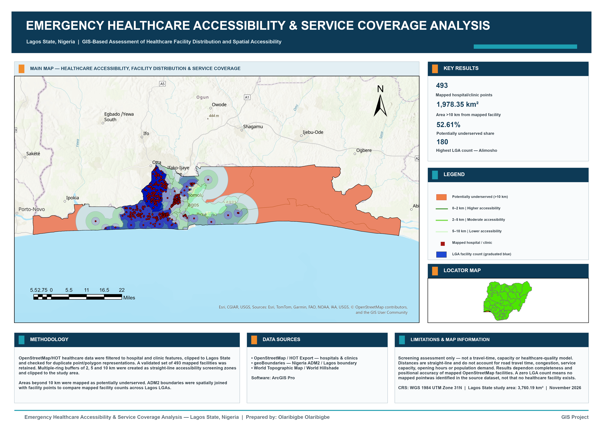

# Emergency Healthcare Accessibility & Service Coverage Analysis — Lagos State, Nigeria

## Project Overview

This project presents a GIS-based screening assessment of healthcare facility distribution and spatial accessibility across Lagos State, Nigeria.

The analysis uses mapped hospital and clinic locations, administrative boundaries and straight-line proximity zones to examine where healthcare facilities are concentrated and which parts of the state lie relatively far from mapped facilities.

The analysis was completed using ArcGIS Pro.

> **Important:** This is a screening-level accessibility assessment. It is not a travel-time, healthcare-capacity or service-quality model.

---

## Project Objective

The analysis was designed to answer four main questions:

- How are mapped hospitals and clinics distributed across Lagos State?
- Which areas fall within 2 km, 5 km and 10 km of mapped healthcare facilities?
- What proportion of the study area lies more than 10 km from a mapped hospital or clinic?
- How do mapped healthcare facility counts vary across Lagos LGAs?

---

## Study Area

**Lagos State, Nigeria**

Coordinate system:

**WGS 1984 UTM Zone 31N**  
EPSG: 32631

Study-area size:

**3,760.19 km²**

---

## Data Sources

### Healthcare Facilities

Healthcare data was obtained from **OpenStreetMap through the HOT Export Tool**.

The dataset was filtered to retain:

- Hospitals
- Clinics

Point and polygon representations were checked for duplicate OSM features before the final facility dataset was validated.

### Administrative Boundaries

Administrative boundaries were obtained from **geoBoundaries**.

Nigeria ADM2 boundaries were used to derive the 20 Lagos Local Government Areas.

### Basemap

World Topographic Map and World Hillshade were used for cartographic context.

---

## GIS Workflow

### 1. Healthcare Data Preparation

OpenStreetMap healthcare features were imported into ArcGIS Pro.

The `amenity` field was used to select:

- `hospital`
- `clinic`

The selected features were clipped to the Lagos State boundary.

A validated total of:

**493 mapped hospital/clinic points**

was retained for the final analysis.

---

### 2. Healthcare Accessibility Zones

Multiple Ring Buffer was used to create straight-line accessibility screening zones around mapped healthcare facilities.

The following distances were used:

- **0–2 km — Higher accessibility**
- **2–5 km — Moderate accessibility**
- **5–10 km — Lower accessibility**

The resulting zones were clipped to Lagos State.

These distances represent GIS screening zones and should not be interpreted as road travel-time catchments.

---

### 3. Potentially Underserved Areas

The 10 km healthcare coverage zone was erased from the Lagos State boundary.

Areas outside the 10 km coverage zone were mapped as:

**Potentially underserved areas (>10 km from a mapped hospital or clinic)**

---

### 4. LGA Facility Distribution

Nigeria ADM2 boundaries were used to identify the 20 Lagos LGAs.

Spatial Join was used to count mapped healthcare facilities within each LGA.

The resulting LGA layer was symbolized using graduated colors based on mapped facility count.

---

## Key Results

| Indicator | Result |
|---|---:|
| Mapped hospital/clinic points | 493 |
| Lagos LGAs analysed | 20 |
| Mean mapped facilities per LGA | 24.65 |
| Highest mapped LGA count | Alimosho — 180 |
| Area within 10 km of mapped facility | 1,781.84 km² |
| Share within 10 km | 47.39% |
| Area beyond 10 km | 1,978.35 km² |
| Potentially underserved share | 52.61% |

Eight LGAs recorded no mapped hospital/clinic points in the source dataset.

This should **not** be interpreted as evidence that no healthcare facilities exist in those LGAs. It reflects the completeness of the OpenStreetMap dataset used for this analysis.

---

## Interpretation

Approximately **1,978.35 km²**, representing **52.61% of the Lagos State study area**, lies more than 10 km from a mapped hospital or clinic.

Approximately **1,781.84 km²**, or **47.39%**, lies within 10 km of a mapped healthcare facility.

The mapped facilities are strongly concentrated in parts of western and central Lagos, while larger portions of eastern Lagos fall outside the 10 km screening coverage.

At LGA level, **Alimosho recorded the highest mapped facility count with 180 points**.

These results highlight spatial differences in the distribution of mapped healthcare facilities and identify areas that may justify more detailed accessibility investigation.

---

## Limitations

This analysis is based on straight-line distance and does not account for:

- Road travel time
- Traffic congestion
- Public transport availability
- Facility capacity
- Staffing
- Service quality
- Opening hours
- Emergency response time
- Population demand

The results also depend on the completeness and positional accuracy of healthcare facilities mapped in OpenStreetMap.

A low or zero mapped facility count therefore does not necessarily mean that healthcare services are absent.

---

## GIS Methods and Tools

- ArcGIS Pro
- OpenStreetMap / HOT data preparation
- Attribute selection
- Clip
- Multiple Ring Buffer
- Erase
- Feature to Point
- Merge
- Find Identical
- Spatial Join
- Graduated-color mapping
- Geometry calculations
- Accessibility screening
- Administrative boundary analysis
- Cartographic layout design
- Spatial-data quality control

---

## Project Files

### Final Map

`Emergency_Healthcare_Accessibility_Lagos.png`

High-resolution final map.

### PDF

`Emergency_Healthcare_Accessibility_Lagos.pdf`

A3 landscape PDF version of the final map.

### ArcGIS Pro Layout

`Lagos_Healthcare_Accessibility_A3_Landscape.pagx`

A3 landscape ArcGIS Pro layout.

### ArcGIS Pro Project

`Emergency_Healthcare_Accessibility_Lagos.aprx`

Main ArcGIS Pro project.

Large raw and intermediate GIS datasets are not included in the repository.

---

## Software

**ArcGIS Pro**

---

## Project Status

**Completed — November 2026**

## Author

**Olaribigbe Olamiposi**

GIS / Geospatial Analyst
